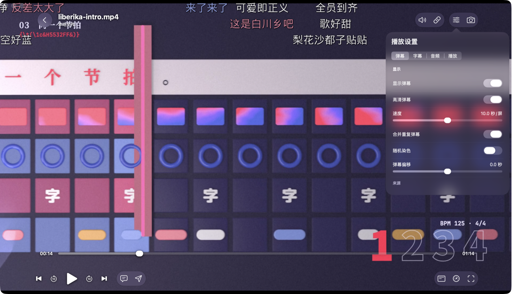

Erika 的第一个公开版本。

Erika 是 [liberika](https://github.com/AimesSoft/liberika) 的官方客户端，一款纯粹、模块化、轻量的 Rust 本地视频播放器。播放全部交给 liberika，界面由 [Bern](https://github.com/AimesSoft/Bern) 编译成各平台自己的原生控件：macOS、iOS 和 Apple TV 用 SwiftUI，Windows 用 WinUI 3，Linux 用 GTK 4，Android 用 Jetpack Compose。

## 这一版有什么

- **播放**：把视频拖进窗口就放，也能打开文件夹和 http(s) 链接。支持硬件解码、HDR 与杜比视界映射、ArtCNN 超分辨率；ASS 字幕由 libass 绘制，弹幕和字幕一起合成在画面里。
- **按需开关的模块**：弹幕、画质增强、媒体库、追番、账号、账号同步、BT 下载、局域网与远程。第一次打开时选「纯粹播放」「看番」「全都要」或者自己挑，之后随时可以在「设置 › 可选功能」里改。
- **远程访问**：打开后，这台设备在 1180 端口提供 WebUI，别的设备用浏览器就能看媒体库、放视频；和 NipaPlay 的远程访问兼容。
- **无头版**：每种电脑系统都有一个没有窗口的包，放在 NAS 或服务器上，用浏览器操作。
- **插件**：JavaScript 插件只能用自己声明过的权限。设置里有插件市场，NipaPlay 的 `.js` 插件也能直接导入。
- **交给 AI**：附带命令行 `erika` 和 MCP 服务器 `erika-mcp`，界面上的每个按钮都能调用。
- **手机、平板、电视和折叠屏**：功能和电脑版相同，布局随设备变化；iPhone Duo 展开后左右分栏。

## 下载哪个

| 设备 | 选这个 | 最低系统 |
| --- | --- | --- |
| Windows | `windows-x64-setup.exe`，Arm 电脑选 `arm64`；免安装版是 `.zip` | Windows 10 2004 |
| Mac | Apple 芯片选 `macos-arm64.dmg`，Intel 选 `macos-x64.dmg` | macOS 14 |
| Linux | Debian、Ubuntu 选 `.deb`，其他发行版选 `.tar.gz` | Ubuntu 26.04 或同样新的发行版（用系统的 FFmpeg 8） |
| Android 手机、平板、电视 | 一般选 `android-arm64.apk`；32 位的旧设备和部分电视盒子选 `armv7`，x86 设备选 `x64` | Android 8.0 |
| iPhone、iPad | `ios-arm64.ipa` | iOS 16 |
| Apple TV | `tvos-arm64.ipa` | tvOS 17 |
| 服务器、NAS | 对应系统的 `-headless` 包 | 同上 |

## 安装前要知道

除了 Android，其他包都没有开发者签名：

- **Mac**：第一次打开会被系统拦下。到「系统设置 › 隐私与安全性」点「仍要打开」，或者在终端运行 `xattr -dr com.apple.quarantine /Applications/Erika.app`。
- **Windows**：SmartScreen 拦下时点「更多信息」，再点「仍要运行」。
- **iPhone、iPad、Apple TV**：`.ipa` 要用 AltStore、Sideloadly 这类工具，以你自己的 Apple ID 签名后安装。

## 无头版怎么用

解压后运行 `bin/erika-host`（Windows 是 `bin\erika-host.exe`）。在本机打开它打印的 `open` 地址；局域网里的其他设备打开 `http://<这台机器的地址>:1180/`。这个端口不要密码，只在信任的网络里用。媒体库要用命令行添加，见 README 的[无头版](https://github.com/AimesSoft/Erika/blob/v0.1.0/README.md#无头版)一节。

## 已知限制

- 播放器只提供 liberika 支持的功能，还没有字幕延迟、音频延迟、画面比例和画中画。
- 网络媒体源只有入口，还没有实际功能。
- 识别电视剧和电影的服务器暂时没有域名，请求走明文 HTTP。
- 远程访问是按 NipaPlay 的接口实现的，还没有和 NipaPlay 应用本身对接测试过。
- 手机、平板和电视版测得比电脑版少，遇到问题欢迎提 [Issue](https://github.com/AimesSoft/Erika/issues)。

## 组件版本

- 播放内核：liberika [0.3.6](https://github.com/AimesSoft/liberika/releases/tag/v0.3.6)
- 界面框架：Bern [`ccfe43f`](https://github.com/AimesSoft/Bern/commit/ccfe43fb53595252e34ed9e10e0ce95beaab1339)

每个文件的 SHA-256 记在 `SHA256SUMS.txt`。

English

The first public release of Erika.

Erika is the official client of [liberika](https://github.com/AimesSoft/liberika): a lean, modular local video player written in Rust. liberika does all of the playback; [Bern](https://github.com/AimesSoft/Bern) compiles the interface into each platform's own native controls: SwiftUI on macOS, iOS and Apple TV, WinUI 3 on Windows, GTK 4 on Linux and Jetpack Compose on Android.

**What's in it**

- **Playback**: drop a video on the window, or open a folder or an http(s) link. Hardware decoding, HDR and Dolby Vision mapping, ArtCNN upscaling; libass draws ASS subtitles, and danmaku is composited into the picture together with them.
- **Modules you switch on as needed**: danmaku, enhancement, library, anime, accounts, sync, BitTorrent downloads, LAN and remote. Pick Pure playback, Anime, Everything or Custom on first launch, and change it any time under Settings › Optional Features.
- **Remote access**: once on, the device serves a WebUI on port 1180, so any browser can browse the library and play videos. It is compatible with NipaPlay's remote access.
- **Headless packages**: a windowless build for each desktop system, for a NAS or a server, used from a browser.
- **Plugins**: JavaScript plugins that can use only the permissions they declare. Settings has a plugin market, and NipaPlay's `.js` plugins import as they are.
- **For AI**: the `erika` command line and the `erika-mcp` server ship with the app; they can reach every button.
- **Phones, tablets, TVs and foldables**: the same features as on the desktop, laid out for each device; an unfolded iPhone Duo shows two panes.

**Which file**

| Device | Pick | Oldest system |
| --- | --- | --- |
| Windows | `windows-x64-setup.exe`, `arm64` on Arm PCs; `.zip` needs no install | Windows 10 2004 |
| Mac | `macos-arm64.dmg` on Apple silicon, `macos-x64.dmg` on Intel | macOS 14 |
| Linux | `.deb` on Debian and Ubuntu, `.tar.gz` elsewhere | Ubuntu 26.04 or as recent (uses the system's FFmpeg 8) |
| Android phone, tablet, TV | usually `android-arm64.apk`; `armv7` for older 32-bit devices and some TV boxes, `x64` for x86 devices | Android 8.0 |
| iPhone, iPad | `ios-arm64.ipa` | iOS 16 |
| Apple TV | `tvos-arm64.ipa` | tvOS 17 |
| Server, NAS | the `-headless` package for its system | as above |

**Before installing**: only the Android packages are signed. On a Mac, allow Erika under System Settings › Privacy & Security › Open Anyway, or run `xattr -dr com.apple.quarantine /Applications/Erika.app`. On Windows, choose More info › Run anyway when SmartScreen stops it. Sign the `.ipa` files with your own Apple ID through a tool such as AltStore or Sideloadly.

**Headless**: unpack and run `bin/erika-host` (`bin\erika-host.exe` on Windows). Open the `open` address it prints on that machine; other devices on the LAN open `http://<its address>:1180/`. That port has no password, so use it only on a network you trust. Add library folders from the command line, as the [Headless section](https://github.com/AimesSoft/Erika/blob/v0.1.0/README.en.md#headless) of the README shows.

**Known limits**: the player offers only what liberika supports, so there is no subtitle delay, audio delay, aspect ratio or picture-in-picture yet. Online sources are only a placeholder. The recognition server for series and films has no domain yet and is reached over plain HTTP. Remote access follows NipaPlay's interface but has not been tried against the NipaPlay app itself. The phone, tablet and TV versions have seen less testing than the desktop ones; please report problems as [issues](https://github.com/AimesSoft/Erika/issues).

**Components**: liberika [0.3.6](https://github.com/AimesSoft/liberika/releases/tag/v0.3.6), Bern [`ccfe43f`](https://github.com/AimesSoft/Bern/commit/ccfe43fb53595252e34ed9e10e0ce95beaab1339). `SHA256SUMS.txt` lists the SHA-256 of every file.

