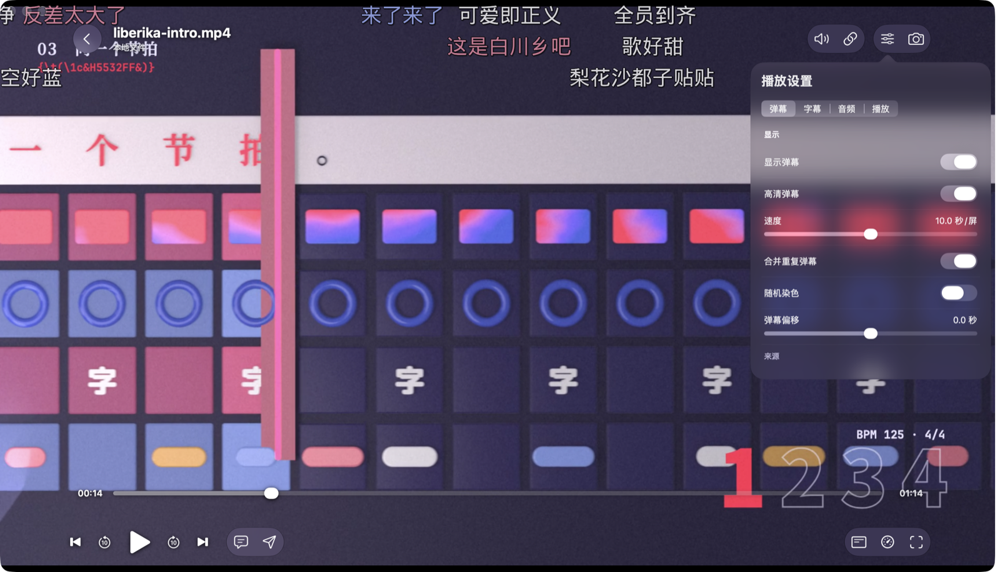
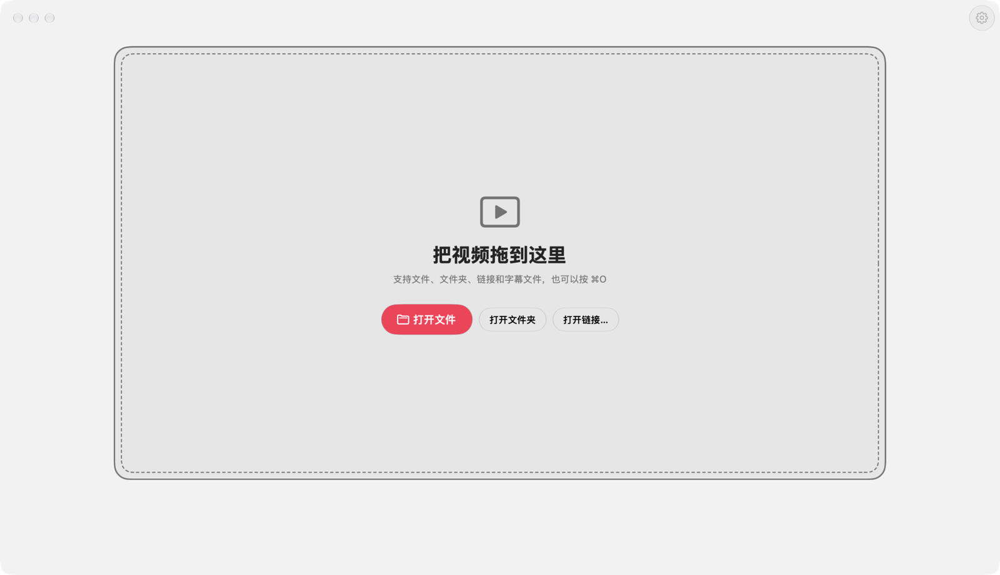
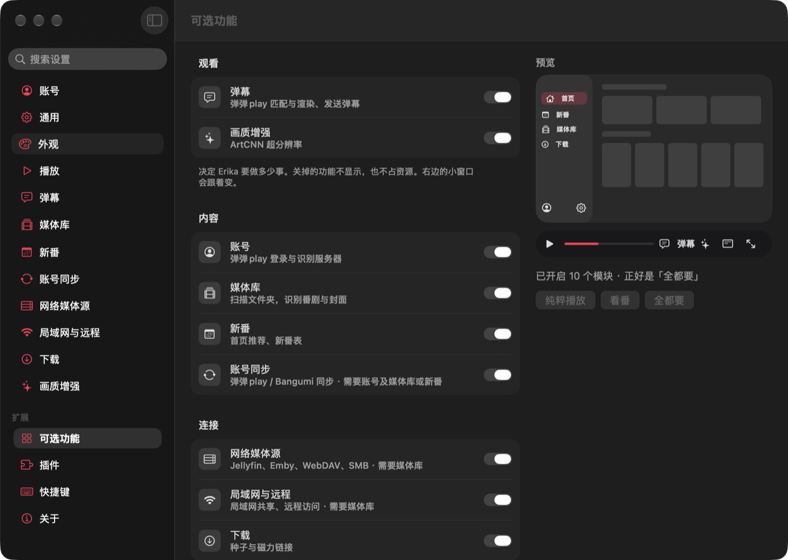

<div align="center">


<h1>
<picture>
<source media="(prefers-color-scheme: dark)" srcset="design/brand/erika-logo-dark.svg">

</picture>
</h1>

<p><b>The official client of liberika. The mpv of the Rust world.</b></p>

<p>A pure, powerful, modular and lightweight local video player written in Rust.<br>
Playback belongs to our own kernel, <a href="https://github.com/AimesSoft/liberika">liberika</a>; <a href="https://github.com/AimesSoft/Bern">Bern</a> compiles the interface into each platform's own native controls.</p>

<p>

<a href="https://github.com/AimesSoft/liberika"></a>
<a href="https://github.com/AimesSoft/Bern"></a>
</p>

<p>


<a href="LICENSE"></a>
</p>

<p><a href="README.md">简体中文</a> · <b>English</b></p>

<p>
<a href="#why-erika">Why Erika</a> ·
<a href="#the-mpv-of-the-rust-world">The mpv of the Rust world</a> ·
<a href="#measurements">Measurements</a> ·
<a href="#what-it-does">What it does</a> ·
<a href="#build-from-source">Build from source</a> ·
<a href="#status">Status</a>
</p>

</div>

<p align="center">
<a href="docs/screenshots/macos-player.png"></a>
<br><sub>Playback: liberika composites the danmaku into the picture</sub>
</p>

<table>
<tr>
<td width="56%" align="center">
<a href="docs/screenshots/macos-pure-light.png"><picture>
<source media="(prefers-color-scheme: dark)" srcset="docs/screenshots/macos-pure-dark.png">
</picture></a>
<br><sub>Pure playback: the window is a frame waiting for a video</sub>
</td>
<td width="44%" align="center">
<a href="docs/screenshots/macos-features.png"></a>
<br><sub>Optional features: one switch per module, and the preview follows</sub>
</td>
</tr>
</table>

<p align="center"><sub>All captured from Erika running on macOS 27, with its interface in Chinese. The video is liberika's intro film.</sub></p>

## Why Erika

- **Pure**: it opens to an empty frame. Drag a video in and it plays. No account, no library to set up first. What you switch off leaves no trace: not in the navigation, not in the menus, not in the settings.
- **Powerful**: liberika does everything from decoding to rendering: hardware decoding, HDR and Dolby Vision mapping, ArtCNN super-resolution, with ASS effect subtitles and danmaku composited into the picture.
- **Modular**: danmaku, library, anime tracking, downloads and more are separate modules. Switch them on and off while running, or leave them out of the build; finer features are JavaScript plugins.
- **Lightweight**: the interface has no drawing engine of its own and no embedded web page: buttons and menus are the system's own controls. The full macOS app is 54.7 MiB, its installer 26.9 MiB, and it uses about 55 MB of memory when idle.

Pick a way to start on first launch. You can change it at any time under Settings › Optional Features:

| Preset | Modules on |
| --- | --- |
| **Pure playback** | None. The window has only the frame and your recent videos |
| **Anime** | Account, danmaku, library, new shows |
| **Everything** | All of them |
| **Custom** | Your choice, one by one |

## The mpv of the Rust world

mpv pairs a kernel, libmpv, with a player. It is written in C, and many players are built on it. Erika and liberika have the same relationship, in Rust: liberika is a kernel any application can embed, and Erika is its official client and its fullest use.

| | mpv | Erika |
| --- | --- | --- |
| **Kernel** | libmpv (C) | [liberika](https://github.com/AimesSoft/liberika) (Rust) |
| **Decoding** | FFmpeg | FFmpeg, dav1d |
| **Subtitles** | libass | libass |
| **Danmaku** | Through third-party scripts | Built into the kernel, composited with the subtitles |
| **Interface** | On-screen controller (OSC) or third-party front ends | Each platform's native controls |
| **Scripting** | Lua, JavaScript | JavaScript plugins, with declared permissions |
| **External control** | JSON IPC | Command line and MCP server; every button can be called |

The same position does not mean the same features. Erika lacks most of the options, filters and configuration mpv has built up over the years. Its player offers only what liberika really supports, and what the kernel does not do has no entry in the interface: there is no subtitle delay, audio delay, aspect ratio or picture in picture yet.

## Measurements

| macOS ARM64 release build | All modules | All modules left out |
| --- | ---: | ---: |
| Full `.app` | **54.73 MiB** | **44.53 MiB** |
| Compressed `.zip` | **26.70 MiB** | **22.40 MiB** |
| Memory when idle | **about 55 MB** | **about 55 MB** |
| Memory playing 1080p | **about 237 MB** | **about 222 MB** |
| CPU playing 1080p | **11–15%** | **15–16%** |

The `.dmg` from `bern package` is **26.9 MiB** (all modules). FFmpeg, dav1d and libass are linked statically, and the `erika` command line and `erika-mcp` are inside, so nothing else needs installing.

For reference, Homebrew's mpv 0.41 on default settings (`--no-config --hwdec=auto`) plays the same file with about 460 MB of memory and 4–9% CPU. That memory includes mpv's larger default cache, so the two setups are not equal and this is only a reference point: Erika uses less memory, and mpv uses less CPU.

Measured on 2026-11-05 on a MacBook Air (Apple M4, 16 GB), macOS 27.2, Bern 0.1.7, liberika `cc297a7`. Memory is the footprint Activity Monitor shows. The all-modules build ran on the Pure playback preset. Idle values were read 8 to 13 seconds after launch. The video is a 1920 × 1080, 30 fps H.264 / AAC file, muted, with hardware decoding on.

## What it does

### Playback

- **Open**: drag into the window, pick a file or a folder, or paste an http(s) link. The videos of a folder become a playlist.
- **Decoding**: hardware decoding (VideoToolbox on macOS, D3D11VA on Windows, NVDEC / VA-API on Linux) falling back to software, and you can turn it off in the settings.
- **Picture**: three renderers, Metal, Direct3D 11 and wgpu. HDR turns on by itself, with Dolby Vision mapping.
- **Pick up where you left off**: progress follows the file (the MD5 of its first 16 MiB plus its size), so a renamed or moved file resumes too.
- **Control**: speed, audio tracks, chapters, opening and ending skip hints, previous and next episode, autoplay, PNG screenshots with subtitles, and a mini player.
- **Shortcuts**: Space, the arrow keys, `F`, `D` and the rest can all be changed in the settings, and conflicts are pointed out.

### Subtitles

Embedded tracks and external files both work. libass draws ASS with the fonts attached to the video, keeping positioning, outlines and effects. The size is adjustable, and double sampling makes subtitles finer.

### Modules

| Module | What it does |
| --- | --- |
| Danmaku `danmaku` | Loads a same-named `.xml` / `.json` by itself and mounts Bilibili XML and dandanplay JSON; signed in to dandanplay, matches danmaku by file fingerprint and sends comments; opacity, size, speed, display area, offset and blocking |
| Upscaling `enhance` | ArtCNN luma super-resolution |
| Library `library` | Scans local folders, recognises anime, TV shows and films, matches by hand; mounts NipaPlay and dandanplay shared media |
| Anime `anime` | Home page, new show schedule, show details and short reviews |
| Account `account` | Signs in to dandanplay and Bangumi |
| Account sync `sync` | One `.ebp` backup file takes all your data along; three-way merge sync over WebDAV; tokens and passwords encrypted with a sync passphrase |
| Downloads `downloads` | BitTorrent: magnet links and `.torrent` files, pause, resume, play while downloading |
| Network sources `sources` | Entry in place, no real function yet |
| LAN and remote `remote` | Turned on, this device becomes a remote access host; see "Remote access" below |

Modules depend on each other: account sync needs the account, and network sources and LAN and remote need the library. Erika follows those dependencies when you switch a module, and a build that leaves out a module something else still needs stops with an error.

### Remote access

Turn on the switch under Settings › LAN and Remote and this device serves on port 1180:

- **Browsers**: open an address the settings list and you get Erika's WebUI. The page and the window share one engine, one library and one set of settings; a video started in the page is decoded and played by the browser, so the other device installs nothing.
- **NipaPlay**: fully compatible with NipaPlay's remote access. NipaPlay finds this device on the network, browses its library, streams video and subtitles by range and writes progress back.
- **Remote control**: other devices can control playback here. The first time is confirmed on this device, and "Trust This Device" stops the question.

The service has no password: the address alone opens it. It is off by default, and meant for networks you trust.

### Headless

Each desktop system has a `headless` package: no window, only `erika-host`, `erika`, `erika-mcp` and the WebUI, for a NAS or a server. Open it in a browser after it starts, or drive it with the command line and MCP.

```sh
bin/erika-host --port 4174
```

It turns remote access on by itself; devices on the network open `http://<this machine>:1180/`.

### Plugins

What not everyone wants is a plugin. The market under Settings › Plugins reads [erika_plugins](https://github.com/AimesSoft/erika_plugins): AI spoiler blocking, a bottom progress line, a danmaku density graph, wider speed range, automatic danmaku offset and more, each one a switch away.

Plugins are written in JavaScript and can call only the permissions they declare. A single plugin ships as an `.epk` file, and NipaPlay's one-file `.js` plugins import directly.

### Appearance

Chinese and English interfaces, light, dark or following the system, four accent colors and two app icons.

## For AI

Every build puts an `erika` command line and an `erika-mcp` server in `target/bern/<target>/bin/`. Both drive the running Erika.

```sh
erika erika open-file --source file:///path/to/video.mkv
erika media state --player-id video
erika ui inspect
```

An AI running these takes the same path as your click. When a button is disabled or a target does not exist, it gets a clear error, not a click that did nothing.

## How Erika does it

**Playback is liberika's job.** Bern's `Video` view gives liberika a native surface and a frame clock. Decoding, audio and video sync, subtitles, danmaku and rendering all happen in the kernel; the interface only sends commands and reads state.

```rust
// erika-ui/src/player.rs
Video(id: video, player: players.video, label: app.title,
      controls: none, sizing: fill, fit: contain)
```

**The interface is written once and compiled into each platform's own code.** It is declared in Rust with Bern's `ui!`, and a build generates SwiftUI, WinUI 3, GTK 4, Jetpack Compose and Web source. Computers, phones and televisions share one engine and one declaration, with different layouts:

```rust
// erika-ui/src/lib.rs
Adaptive(id: shell) {
    Layout(size: compact) { phone_shell(/* … */) }
    Layout(size: tv) { tv_shell(/* … */) }
    Layout(size: expanded) { /* … */ }
}
```

**Modules are real modules.** Each has its own protocol, engine and interface under `modules/<module>/`, and `optional = true` lets it switch off at run time. Leave one out of a build with `--exclude-module`, and it never enters the generated project, neither its code nor its dependencies:

```sh
# Keep only the shell and basic playback
bern build --target macos --release \
  --exclude-module account,danmaku,enhance,anime,library,sync,sources,remote,downloads
```

**The command line and MCP server come from the same protocol.** Every command in the protocol and every control in the interface has a name, and Bern generates `erika` and `erika-mcp` from them.

## Download

Releases are on the [Releases](https://github.com/AimesSoft/Erika/releases) page, named `Erika-<version>-<system>-<architecture>[-headless]`.

| System | Architecture | Package |
| --- | --- | --- |
| macOS | `x64`, `arm64` | `.dmg`; headless `-headless.zip` |
| Windows | `x64`, `arm64` | `-setup.exe`, `.zip`; headless `-headless.zip` |
| Linux | `x64`, `arm64` | `.deb`, `.tar.gz`; headless `-headless.tar.gz` |
| Android (phones, tablets, TV) | `arm64`, `armv7`, `x64` | `.apk` |
| iOS, iPadOS | `arm64` | `.ipa`, iOS 16 and later |
| Apple TV | `arm64` | `.ipa` |

The macOS, iOS, Apple TV and Windows packages have no developer signature: sign an `.ipa` with your own Apple ID through AltStore, Sideloadly or the like. The Linux build uses the system's FFmpeg 8, so it needs Ubuntu 26.04 or a distribution as recent.

## Platforms

| Platform | Interface | Picture | Playback |
| --- | --- | --- | --- |
| macOS | SwiftUI | Metal | ✅ liberika |
| Windows | WinUI 3 | Direct3D 11 | ✅ liberika |
| Linux | GTK 4 | wgpu | ✅ liberika |
| Web | DOM + WebAssembly | WebCodecs + WebGL2 | ✅ liberika's browser backend |
| iOS, iPadOS | SwiftUI | Metal | ✅ liberika |
| Apple TV | SwiftUI | Metal | ✅ liberika |
| Android, Android TV | Jetpack Compose | Vulkan (wgpu) | ✅ liberika |

The web comes in two forms: `web_app` compiles the engine into the page and deploys as static files; the page of `web_ui` connects to a native `erika-host`.

## Build from source

Install [Rust](https://rustup.rs/) first. `rust-toolchain.toml` pins Rust 1.99.0, and the first Cargo run selects it. Then install Bern's build tool, `bern`, at the version of the Bern Erika uses:

```sh
cargo install --locked --git https://github.com/AimesSoft/Bern --rev 06d2cb9dc8f740e5a09cc1f69e08d4d43881da16 bern-cli
```

Get Erika, then prepare liberika's native dependencies (FFmpeg, dav1d, libass and others, built statically, once):

```sh
git clone https://github.com/AimesSoft/Erika.git
cd Erika

ERIKA_LIBERIKA_ROOT="$(python3 web/dependencies.py)"
cargo run --manifest-path "$ERIKA_LIBERIKA_ROOT/Cargo.toml" -p xtask -- \
  deps build --all --profile lgpl --target aarch64-apple-darwin
```

Change `--target` to this computer's. This step needs cmake, meson, ninja and pkg-config (from Homebrew on macOS). Windows and Linux prepare these differently; see [the dependency notes](docs/dependencies.md#原生播放依赖) (in Chinese).

Then run it:

```sh
bern run
```

The native dependencies of phones and televisions build for their own targets; the commands are in the [release workflow](.github/workflows/release.yml).

`bern run` builds and opens the version for this computer. `bern build --target <target> --release` builds one target, `bern package --target <target>` makes an installer, and `bern doctor` lists what this computer still needs for each target.

| Target | Platform |
| --- | --- |
| `macos` | macOS |
| `windows` | Windows |
| `linux` | Linux. Needs liberika's `wgpu-hal` patch, in `.cargo/config.toml`; see [the dependency notes](docs/dependencies.md#本地使用相邻源码) |
| `web_app`, `web_ui` | Browsers. Also needs Emscripten; see [browser playback](docs/web-playback.md) |
| `ios`, `tvos` | Simulators |
| `android` | Android phones |

To change Bern or liberika at the same time, put them beside Erika and copy `.cargo/config.local.example.toml` to `.cargo/config.toml`.

## Status

Erika is in development, at version 0.1.0.

- **Played video on**: a Mac, a Windows PC, a Steam Deck (SteamOS, Wayland), Chrome, the iPhone, iPad, iPhone Duo and Apple TV simulators, and Android phone, tablet and Android TV emulators.
- **Not on real devices yet**: iOS, Apple TV and Android have played with the real kernel in simulators only.
- **Still placeholders**: network sources.
- **Recognition server**: TV shows and films are recognised by the server built into Erika. It has no domain yet, so its requests travel as plain HTTP.

Remote access follows NipaPlay's source and was checked route by route with a simulated client; it has not been tried against the NipaPlay app itself.

## Repository

| Path | Contents |
| --- | --- |
| `Bern.toml` | The application manifest: languages, modules, targets |
| `erika-protocol/` | The shell's protocol: state and commands |
| `erika-core/` | The shell's engine: playback, settings, accounts, plugins |
| `erika-ui/` | The shell's interface: windows, sidebar, player, settings, first launch |
| `erika-store/` | The SQLite database on the device |
| `erika-dandanplay/` | Clients of dandanplay and the recognition server |
| `erika-torrent/` | BitTorrent downloads |
| `erika-gateway/` | The fingerprint gateway in front of the recognition server |
| `modules/` | The nine optional modules, each with `protocol`, `core` and `ui` |
| `web/` | The browser playback extension and its tests |
| `server/` | The public cache of new shows and reviews |
| `docs/` | [Technical notes](docs/README.md) (in Chinese) |
| `design/` | Interface design documents, prototypes and brand assets |

## License and thanks

Erika's code is under the [MIT License](LICENSE). The posters and third-party icons in `design/assets/` belong to their owners and are not covered by it. Erika is a player and provides no video content; danmaku and show data come from the third-party services below.

- [liberika](https://github.com/AimesSoft/liberika): the playback kernel, MPL-2.0
- [Bern](https://github.com/AimesSoft/Bern): the interface framework, MIT
- [FFmpeg](https://ffmpeg.org/) (LGPL build), [dav1d](https://code.videolan.org/videolan/dav1d), [libass](https://github.com/libass/libass): decoding and subtitles
- [librqbit](https://github.com/ikatson/rqbit): BitTorrent downloads
- [dandanplay](https://www.dandanplay.com/), [Bangumi](https://bgm.tv/), [bangumi-data](https://github.com/bangumi-data/bangumi-data): danmaku, show data and air times
- [Misaka danmaku server](https://github.com/l429609201/misaka_danmu_server): recognising TV shows and films
- [Boa](https://github.com/boa-dev/boa): running plugins where the system has no JavaScript engine
- [NipaPlay](https://github.com/AimesSoft/NipaPlay-Reload): where the ways of scanning, downloading, syncing and the plugin interface come from
- [mpv](https://mpv.io/): the player Erika looks up to
