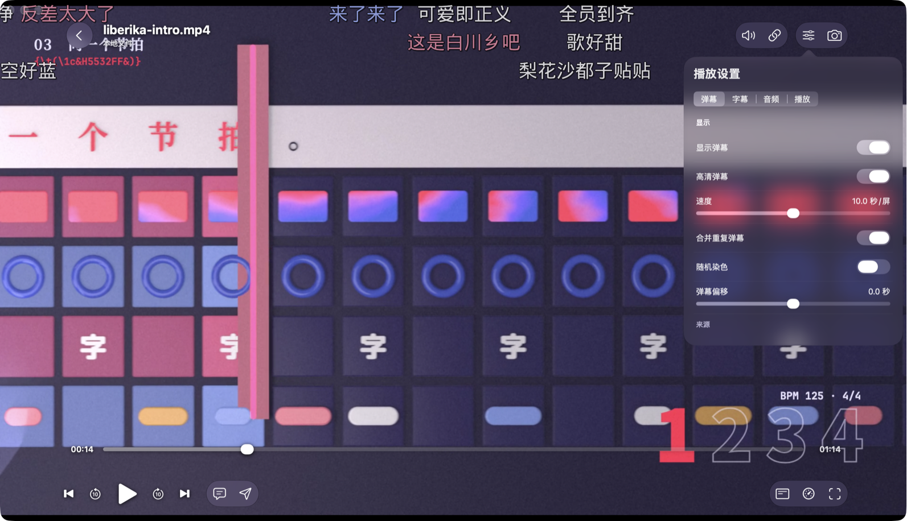
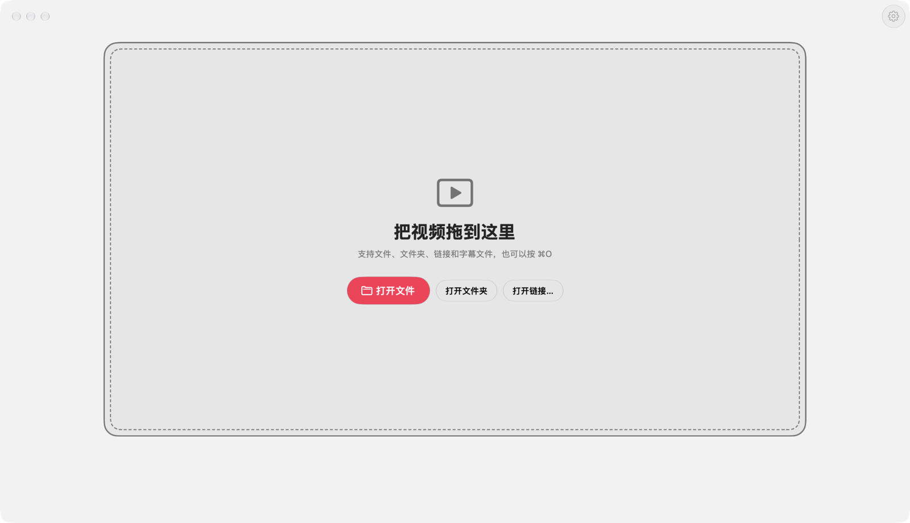
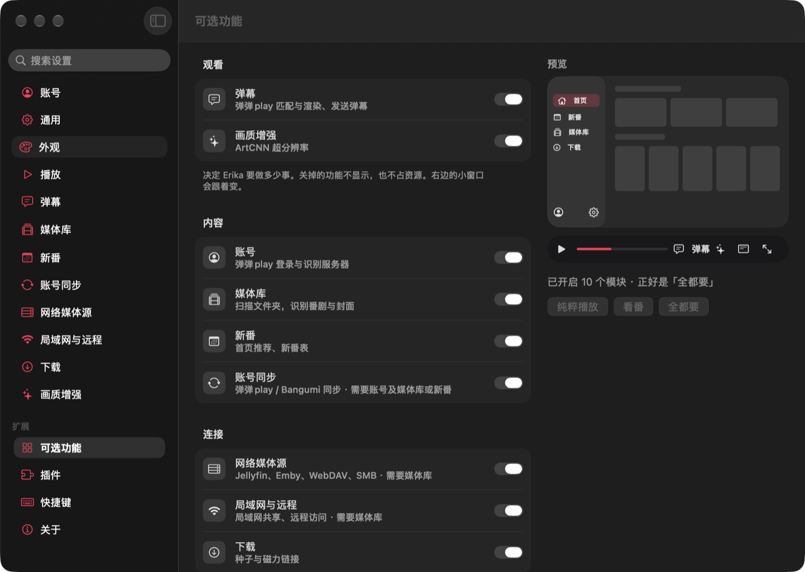

<div align="center">


<h1>
<picture>
<source media="(prefers-color-scheme: dark)" srcset="design/brand/erika-logo-dark.svg">

</picture>
</h1>

<p><b>liberika 的官方客户端，Rust 领域的 mpv。</b></p>

<p>一款纯粹、强大、模块化、轻量的 Rust 本地视频播放器。<br>
播放全部交给自研内核 <a href="https://github.com/AimesSoft/liberika">liberika</a>，界面由 <a href="https://github.com/AimesSoft/Bern">Bern</a> 编译成每个平台自己的原生控件。</p>

<p>

<a href="https://github.com/AimesSoft/liberika"></a>
<a href="https://github.com/AimesSoft/Bern"></a>
</p>

<p>


<a href="LICENSE"></a>
</p>

<p><b>简体中文</b> · <a href="README.en.md">English</a></p>

<p>
<a href="#为什么是-erika">为什么是 Erika</a> ·
<a href="#rust-领域的-mpv">Rust 领域的 mpv</a> ·
<a href="#实测数据">实测数据</a> ·
<a href="#能做什么">能做什么</a> ·
<a href="#从源码构建">从源码构建</a> ·
<a href="#现状">现状</a>
</p>

</div>

<p align="center">
<a href="docs/screenshots/macos-player.png"></a>
<br><sub>播放：弹幕由 liberika 合成在画面里</sub>
</p>

<table>
<tr>
<td width="56%" align="center">
<a href="docs/screenshots/macos-pure-light.png"><picture>
<source media="(prefers-color-scheme: dark)" srcset="docs/screenshots/macos-pure-dark.png">
</picture></a>
<br><sub>纯粹播放：窗口里只有一个等着视频的画框</sub>
</td>
<td width="44%" align="center">
<a href="docs/screenshots/macos-features.png"></a>
<br><sub>可选功能：每个模块一个开关，右边的小窗跟着变</sub>
</td>
</tr>
</table>

<p align="center"><sub>以上都是 macOS 27 上的真实运行画面，视频是 liberika 的介绍片。</sub></p>

## 为什么是 Erika

- **纯粹**：打开就是一个空画框，把视频拖进去就放。不用账号，不用先建媒体库。关掉的功能不留痕迹：不进导航、不进菜单、不进设置。
- **强大**：liberika 从解码到渲染一手包办：硬件解码、HDR 与杜比视界映射、ArtCNN 超分辨率，ASS 特效字幕和弹幕都合成在画面里。
- **模块化**：弹幕、媒体库、追番、下载等都是独立模块，运行时随时开关，编译时可以整个裁掉；更细的功能写成 JavaScript 插件。
- **轻量**：界面没有自绘引擎，也没有内嵌网页，按钮和菜单都是系统自己的控件。macOS 版的完整应用 54.7 MiB，打成安装包 26.9 MiB，空闲时占用约 55 MB 内存。

第一次打开时选一种方式，之后随时可以在「设置 › 可选功能」里改：

| 预设 | 打开的模块 |
| --- | --- |
| **纯粹播放** | 无。窗口只有画框和最近播放 |
| **看番** | 账号、弹幕、媒体库、新番 |
| **全都要** | 全部模块 |
| **自己挑** | 逐个选择 |

## Rust 领域的 mpv

mpv 把内核 libmpv 和播放器放在一起，用 C 写成，很多播放器都在它上面搭建。Erika 和 liberika 是同样的关系，只是换成了 Rust：liberika 是一个可以嵌入任何应用的内核，Erika 是它的官方客户端，也是它最完整的用法。

| | mpv | Erika |
| --- | --- | --- |
| **内核** | libmpv（C） | [liberika](https://github.com/AimesSoft/liberika)（Rust） |
| **解码** | FFmpeg | FFmpeg、dav1d |
| **字幕** | libass | libass |
| **弹幕** | 靠第三方脚本 | 内核自带，和字幕一起合成 |
| **界面** | 屏幕控制器（OSC）或第三方前端 | 各平台的原生控件 |
| **脚本** | Lua、JavaScript | JavaScript 插件，按权限运行 |
| **外部控制** | JSON IPC | 命令行与 MCP 服务器，每个按钮都能调用 |

定位相同，不代表功能相同。mpv 多年积累的选项、滤镜和配置方式，Erika 大多还没有。Erika 的播放器只提供 liberika 真正支持的功能，内核没有的，界面上就没有入口：现在没有字幕延迟、音频延迟、画面比例和画中画。

## 实测数据

| macOS ARM64 Release 构建 | 全部模块 | 裁掉全部模块 |
| --- | ---: | ---: |
| 完整 `.app` | **54.73 MiB** | **44.53 MiB** |
| 压缩后的 `.zip` | **26.70 MiB** | **22.40 MiB** |
| 空闲时内存 | **约 55 MB** | **约 55 MB** |
| 放 1080p 视频时内存 | **约 237 MB** | **约 222 MB** |
| 放 1080p 视频时 CPU | **11–15%** | **15–16%** |

`bern package` 打出的 `.dmg` 是 **26.9 MiB**（全部模块）。包里已经静态链接 FFmpeg、dav1d 和 libass，还带着 `erika` 命令行和 `erika-mcp`，不需要另外安装什么。

作为参照，Homebrew 的 mpv 0.41 用默认设置（`--no-config --hwdec=auto`）放同一个文件，内存约 460 MB，CPU 4–9%。mpv 的内存里有它默认较大的缓存，两边的配置并不对等，这里只作参考：Erika 占的内存更少，mpv 占的 CPU 更少。

测量于 2026-11-05，MacBook Air（Apple M4，16 GB），macOS 27.2，Bern 0.1.7，liberika `cc297a7`。内存是系统「活动监视器」用的 footprint；「全部模块」的版本运行在纯粹播放预设下。空闲是启动 8 到 13 秒后的数值，播放的是 1920 × 1080、30 fps 的 H.264 / AAC 文件，静音，开着硬件解码。

## 能做什么

### 播放

- **打开**：拖入窗口、选文件、选文件夹，或者粘贴 http(s) 链接。文件夹里的视频自动排成播放列表。
- **解码**：硬件解码（macOS 用 VideoToolbox，Windows 用 D3D11VA，Linux 用 NVDEC / VA-API），失败时回退软件解码，也可以在设置里关掉。
- **画面**：Metal、Direct3D 11 和 wgpu 三套渲染；HDR 自动启用，支持杜比视界映射。
- **接着看**：进度跟着文件走（前 16 MiB 的 MD5 加文件大小），文件改了名、换了地方也能接上。
- **控制**：倍速、音轨切换、章节跳转、片头片尾跳过提示、上下集与自动连播、带字幕的 PNG 截图、迷你播放器。
- **快捷键**：空格、方向键、`F`、`D` 这些默认按键都能在设置里改，互相冲突时会告诉你。

### 字幕

内嵌轨道和外挂文件都能用。ASS 由 libass 绘制，读取视频里附带的字体，定位、描边和特效都还原；字号可调，可以开双倍采样让字幕更细腻。

### 模块

| 模块 | 做什么 |
| --- | --- |
| 弹幕 `danmaku` | 自动加载同名 `.xml` / `.json`，挂载 B 站 XML 与弹弹play JSON；登录弹弹play 后按文件指纹匹配弹幕、发送弹幕；透明度、字号、速度、显示区域、偏移和屏蔽 |
| 画质增强 `enhance` | ArtCNN 亮度超分辨率 |
| 媒体库 `library` | 扫描本地文件夹，自动认出番剧、电视剧和电影，手动匹配；挂载 NipaPlay 与弹弹play 的共享媒体 |
| 追番 `anime` | 首页、新番时间表、番剧详情与短评 |
| 账号 `account` | 登录弹弹play 与 Bangumi |
| 账号同步 `sync` | 一个 `.ebp` 备份文件带走全部数据；WebDAV 三方合并同步；令牌和密码用同步口令加密 |
| 下载 `downloads` | BT 下载：磁力链接和 `.torrent`，暂停、续传、边下边播 |
| 网络媒体源 `sources` | 入口已留好，还没有实际功能 |
| 局域网与远程 `remote` | 打开后这台设备就是一台远程访问主机，见下面的「远程访问」 |

模块之间有依赖：账号同步需要账号，网络媒体源与局域网和远程需要媒体库。开关时 Erika 会按依赖处理；构建时排除了还被依赖的模块，会直接报错。

### 远程访问

打开「设置 › 局域网与远程」里的开关，这台设备就在端口 1180 上服务：

- **浏览器**：直接打开设置里列出的地址，就是 Erika 的 WebUI。页面和窗口共用同一个引擎，看同一份媒体库和设置；在页面里开始的视频由浏览器解码播放，别的设备不用安装任何东西。
- **NipaPlay**：和 NipaPlay 的远程访问完全兼容。NipaPlay 能在局域网里发现这台设备，看它的媒体库、按范围串流视频和字幕，写回播放进度。
- **遥控**：其他设备可以控制这里的播放，第一次要在这台设备上确认，勾选「信任此设备」后不再询问。

这个服务不要密码，地址就能打开，所以默认关闭，只在信任的网络里打开。

### 无头版

每种电脑系统都有一个 `headless` 包，没有窗口，适合放在 NAS 或服务器上。平时在浏览器里用 WebUI 操作，界面和桌面版一样；命令行 `erika` 和 MCP 服务器 `erika-mcp` 给脚本和 AI 用，三者连的是同一个引擎。

解压后运行 `bin/erika-host`（Windows 是 `bin\erika-host.exe`），它在前台运行，启动后打印两行：

```text
engine 76b71933e38e00
open http://127.0.0.1:4179/#token=dd825a72…
```

- **这台机器上**：打开 `open` 后面的地址。它只监听本机，地址里的 token 就是口令。端口每次随机，用 `--port 4179` 可以固定。
- **局域网里的其他设备**：打开 `http://<这台机器的地址>:1180/`。无头版第一次启动时就打开远程访问，这个服务不要密码，只放在信任的网络里。

浏览器的文件夹选择器读不到服务器的磁盘，媒体库用命令行添加，`--engine` 填启动时打印的那个编号：

```sh
bin/erika --engine 76b71933e38e00 library add-folder --folder '{"url":"file:///srv/anime/"}' --content Anime
```

`--content` 可以是 `Anime`、`Series` 或 `Movie`。远程访问的开关和端口在 WebUI 的「设置 › 局域网与远程」，也可以用命令行改：

```sh
bin/erika --engine 76b71933e38e00 remote set-port --port 8080
bin/erika --engine 76b71933e38e00 remote set-enabled --enabled false
```

设置和媒体库保存在系统的应用数据目录，重启后还在。要长期运行，交给 systemd、launchd 这类服务管理器。macOS 的包没有签名，从浏览器下载后先运行 `xattr -dr com.apple.quarantine <解压出的文件夹>`。

### 插件

不是人人都要的功能写成插件。「设置 › 插件」里的市场读 [erika_plugins](https://github.com/AimesSoft/erika_plugins)：AI 防剧透、底部进度条、弹幕密度图、倍速扩展、自动弹幕偏移等，打开开关就能用。

插件用 JavaScript 编写，只能调用自己声明过的权限。单独分发时是一个 `.epk` 文件，NipaPlay 的单文件 `.js` 插件也能直接导入。

### 外观

中文和英文界面，浅色、深色或跟随系统，四种主题色，两款应用图标。

## 交给 AI

每次构建都会在 `target/bern/<平台>/bin/` 生成 `erika` 命令行和 `erika-mcp` 服务器，它们驱动的是正在运行的 Erika。

```sh
erika erika open-file --source file:///path/to/video.mkv
erika media state --player-id video
erika ui inspect
```

AI 执行这些命令和你点按钮走的是同一条路。按钮被禁用或目标不存在时，它收到的是明确的错误，不是一次没有效果的点击。

## Erika 是怎么做到的

**播放是 liberika 的事。** Bern 的 `Video` 视图给 liberika 一个原生表面和帧时钟，之后的解码、音画同步、字幕、弹幕和渲染都在内核里完成，界面只发命令、读状态。

```rust
// erika-ui/src/player.rs
Video(id: video, player: players.video, label: app.title,
      controls: none, sizing: fill, fit: contain)
```

**界面写一次，编译成各平台自己的代码。** 界面用 Bern 的 `ui!` 声明写在 Rust 里，构建时生成 SwiftUI、WinUI 3、GTK 4、Jetpack Compose 和 Web 的源码。电脑、手机和电视共用同一份引擎和声明，只是布局不同：

```rust
// erika-ui/src/lib.rs
Adaptive(id: shell) {
    Layout(size: compact) { phone_shell(/* … */) }
    Layout(size: tv) { tv_shell(/* … */) }
    Layout(size: expanded) { /* … */ }
}
```

**模块是真的模块。** 每个模块有自己的协议、引擎和界面，放在 `modules/<模块>/`，`optional = true` 让它能在运行时关闭。构建时用 `--exclude-module` 排除，它不会进生成的工程，代码和依赖都不在包里：

```sh
# 只保留外壳与基础播放
bern build --target macos --release \
  --exclude-module account,danmaku,enhance,anime,library,sync,sources,remote,downloads
```

**命令行和 MCP 来自同一份协议。** 协议里的每条命令、界面上的每个控件都有名字，Bern 据此生成 `erika` 和 `erika-mcp`。

## 下载

在 [Releases](https://github.com/AimesSoft/Erika/releases) 下载，文件名是 `Erika-版本-系统-架构[-headless]`。

| 系统 | 架构 | 包 |
| --- | --- | --- |
| macOS | `x64`、`arm64` | `.dmg`；无头版 `-headless.zip` |
| Windows | `x64`、`arm64` | `-setup.exe`、`.zip`；无头版 `-headless.zip` |
| Linux | `x64`、`arm64` | `.deb`、`.tar.gz`；无头版 `-headless.tar.gz` |
| Android（手机、平板、电视） | `arm64`、`armv7`、`x64` | `.apk` |
| iOS、iPadOS | `arm64` | `.ipa`，iOS 16 起 |
| Apple TV | `arm64` | `.ipa` |

macOS、iOS、Apple TV 和 Windows 的包没有开发者签名：`.ipa` 要用 AltStore、Sideloadly 等工具以自己的 Apple ID 签名安装。Linux 版使用系统的 FFmpeg 8，需要 Ubuntu 26.04 或同样新的发行版。

## 平台

| 平台 | 界面 | 画面 | 播放 |
| --- | --- | --- | --- |
| macOS | SwiftUI | Metal | ✅ liberika |
| Windows | WinUI 3 | Direct3D 11 | ✅ liberika |
| Linux | GTK 4 | wgpu | ✅ liberika |
| Web | DOM + WebAssembly | WebCodecs + WebGL2 | ✅ liberika 的浏览器后端 |
| iOS、iPadOS | SwiftUI | Metal | ✅ liberika |
| Apple TV | SwiftUI | Metal | ✅ liberika |
| Android、Android TV | Jetpack Compose | Vulkan（wgpu） | ✅ liberika |

Web 有两种形态：`web_app` 把引擎也编译进页面，纯静态部署；`web_ui` 的页面连接一个原生的 `erika-host`。

## 从源码构建

先装好 [Rust](https://rustup.rs/)，`rust-toolchain.toml` 固定了 Rust 1.99.0，第一次运行 Cargo 时会自动选择。然后装上 Bern 的构建工具 `bern`，版本和 Erika 用的 Bern 一致：

```sh
cargo install --locked --git https://github.com/AimesSoft/Bern --rev ccfe43fb53595252e34ed9e10e0ce95beaab1339 bern-cli
```

取得 Erika，再准备 liberika 的原生依赖（FFmpeg、dav1d、libass 等，静态编译，一次即可）：

```sh
git clone https://github.com/AimesSoft/Erika.git
cd Erika

ERIKA_LIBERIKA_ROOT="$(python3 web/dependencies.py)"
cargo run --manifest-path "$ERIKA_LIBERIKA_ROOT/Cargo.toml" -p xtask -- \
  deps build --all --profile lgpl --target aarch64-apple-darwin
```

`--target` 换成这台电脑的平台。这一步需要 cmake、meson、ninja 和 pkg-config（macOS 上用 Homebrew 安装）。Windows 和 Linux 的准备方式不同，见[依赖说明](docs/dependencies.md#原生播放依赖)。

然后运行：

```sh
bern run
```

手机和电视的原生依赖按它们的目标编译，具体命令见 [发版工作流](.github/workflows/release.yml)。

`bern run` 构建并打开这台电脑上的版本。`bern build --target <平台> --release` 构建某个平台，`bern package --target <平台>` 生成安装包，`bern doctor` 列出这台电脑构建各平台还缺什么。

| 目标 | 平台 |
| --- | --- |
| `macos` | macOS |
| `windows` | Windows |
| `linux` | Linux。需要 liberika 的 `wgpu-hal` 补丁，写进 `.cargo/config.toml`，见[依赖说明](docs/dependencies.md#本地使用相邻源码) |
| `web_app`、`web_ui` | 浏览器。另需 Emscripten，见[浏览器播放](docs/web-playback.md) |
| `ios`、`tvos` | 模拟器 |
| `android` | Android 手机 |

同时修改 Bern 或 liberika 时，把它们放在 Erika 旁边，再把 `.cargo/config.local.example.toml` 复制成 `.cargo/config.toml`。

## 现状

Erika 还在开发中，版本号是 0.1.0。

- **实际播放过**：macOS 实机、Windows 实机、Steam Deck（SteamOS，Wayland）、Chrome，iPhone、iPad、iPhone Duo 与 Apple TV 模拟器，Android 手机、平板与 Android TV 模拟器。
- **还没上真机**：iOS、Apple TV 与 Android 目前只在模拟器上用真实内核播放过。
- **还是示例或占位**：网络媒体源。
- **识别服务器**：电视剧和电影由 Erika 内置的识别服务器认，它现在没有域名，请求走明文 HTTP。

远程访问的接口按 NipaPlay 的源码实现，用模拟客户端逐条验证过，还没有和 NipaPlay 应用本身对接测试。

## 仓库结构

| 路径 | 内容 |
| --- | --- |
| `Bern.toml` | 应用清单：语言、模块、构建目标 |
| `erika-protocol/` | 外壳的协议：状态与命令 |
| `erika-core/` | 外壳的引擎：播放、设置、账号、插件 |
| `erika-ui/` | 外壳的界面：窗口、侧栏、播放器、设置、首次启动 |
| `erika-store/` | 设备上的 SQLite 数据库 |
| `erika-dandanplay/` | 弹弹play 与识别服务器的客户端 |
| `erika-torrent/` | BT 下载 |
| `erika-gateway/` | 识别服务器前面的指纹网关 |
| `modules/` | 九个可选模块，各有 `protocol`、`core`、`ui` |
| `web/` | 浏览器播放的扩展与测试 |
| `server/` | 新番与评论的公开缓存服务 |
| `docs/` | [技术文档](docs/README.md) |
| `design/` | 界面设计文档、交互原型和品牌素材 |

## 开源协议与致谢

Erika 的代码使用 [MIT 协议](LICENSE)。`design/assets/` 里的海报和第三方图标归各自的权利人所有，不在此列。Erika 是播放器，不提供任何视频内容；弹幕和番剧资料来自下面的第三方服务。

- [liberika](https://github.com/AimesSoft/liberika)：播放内核，MPL-2.0
- [Bern](https://github.com/AimesSoft/Bern)：界面框架，MIT
- [FFmpeg](https://ffmpeg.org/)（LGPL 构建）、[dav1d](https://code.videolan.org/videolan/dav1d)、[libass](https://github.com/libass/libass)：解码与字幕
- [librqbit](https://github.com/ikatson/rqbit)：BT 下载
- [弹弹play](https://www.dandanplay.com/)、[Bangumi](https://bgm.tv/)、[bangumi-data](https://github.com/bangumi-data/bangumi-data)：弹幕、番剧资料与放送时间
- [Misaka 弹幕服务](https://github.com/l429609201/misaka_danmu_server)：电视剧与电影的识别
- [Boa](https://github.com/boa-dev/boa)：没有系统 JavaScript 引擎的平台上运行插件
- [NipaPlay](https://github.com/AimesSoft/NipaPlay-Reload)：扫描、下载、同步与插件接口的做法来自这里
- [mpv](https://mpv.io/)：Erika 的榜样
